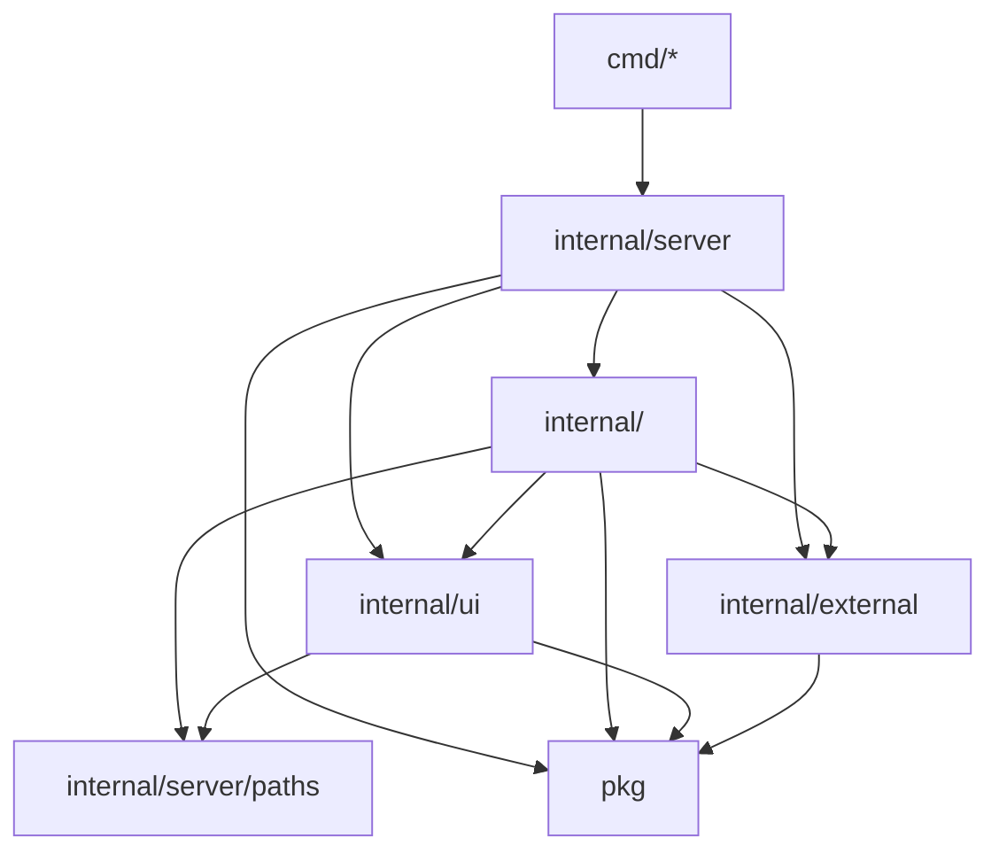

# LEANGO: the lean-go architecture

A template for server-rendered Go apps: `net/http`, PostgreSQL through sqlc, gomponents,
htmx, Alpine, Tailwind and daisyUI. No router framework, ORM, DI container or `init()` registration.
Application-specific behavior belongs in [README.md](README.md) and feature guides, not here.
The quality bar is [CONSTRAINTS.md](CONSTRAINTS.md); implementation recipes are in
[docs/conventions](docs/conventions/), selected by [AGENTS.md](AGENTS.md).

## Start a project

**Do** use GitHub's **Use this template**, clone the new repository, then:

1. Rename the Go module and its Go import paths from `github.com/tung-dnt/lean-go` to your module.
   Update the `module` constant in `internal/architecture_test.go` too.
2. Rename `leango` in local database settings, Docker Compose and `package.json` to your app name.
3. Run `just install && just db-up && just migrate-up && just run`; open <http://localhost:8000>.
4. Copy the shape of `internal/note` for the first real domain, then remove the example's package,
   routes, paths, migration, queries, architecture-test row and `web/js/note` area together.
5. Set the owner/date in `CONSTRAINTS.md` and fill in the README's project-specific sections.
6. Set `GO_APP_ENCRYPTIONKEY` and database credentials in every live environment.

**Don't** ship the public key or local credentials from `config/config.yaml`, keep two competing
module paths, or leave example routes available just because nothing links to them.

## Package boundaries

```text
cmd/web/                 entrypoint: calls server.Run
cmd/admin/               create the admin account
internal/server/         config, concrete wiring, routes, middleware, shutdown
internal/server/paths/   typed paths used by links, forms and redirects
internal/server/servertest/ real server test harness
internal/ui/             page shell, layouts and shared components
internal/<domain>/       one flat package per domain
internal/external/db/    migrations, SQL queries, generated sqlc code
pkg/                     domain-independent mechanisms, including workflow and worker
web/js/                  browser areas with explicit import edges
public/                  embedded assets
```



**Do** inspect `pkg/` before implementing a mechanism. Read its contract and callers and reuse
what fits. Keep third-party SDK adapters under `internal/external`; generated sqlc files are never
hand-edited. Add any cross-domain import explicitly to `domains` in `internal/architecture_test.go`.
Domains link to each other's pages through typed paths instead of importing each other's handlers.

**Don't** import a domain, server or UI from `pkg` or `internal/external`. UI imports no domain and
only `internal/server/paths` from server; paths imports nothing from the module. `cmd/*` imports
server, pkg and external plus explicitly listed `cmdAllowed` edges (`cmd/admin` uses auth).
The architecture test enforces these edges and rejects the router/validation libraries replaced
by the standard library.

## Flat domains, named by concern and role

**Do** keep related functions in one package and name files so a reader can locate a concern without
opening every file. One example domain, including an optional workflow's file layout:

```text
internal/note/
  note_http.go
  note_views.go
  note_test.go
  publication_api.go
  publication_http.go
  publication_views.go
  publication_store.go
  publication_worker.go
  publication_workflow_definition.go
  publication_workflow_prepare.go
  publication_workflow_publish.go
  publication_workflow_error.go
```

Only `note_http.go`, `note_views.go` and `note_test.go` are supplied in this example domain.
The `publication_*` entries show where a real multi-step concern would go; simple note CRUD
needs neither a workflow nor a background worker.

| File pattern | Owns |
|---|---|
| `<concern>_api.go` | Domain entrypoints and concrete construction |
| `<concern>_http.go` | Handler makers, HTTP input and response mapping |
| `<concern>_views.go` | That concern's gomponents and rendering |
| `<concern>_query.go`, `<concern>_policy.go` | Reads or pure decisions when they merit a separate file |
| `<concern>_store.go` | SQL/transaction adapter and persistence invariants |
| `<concern>_worker.go` | Domain callbacks, durable scanning and scheduling policy |
| `<concern>_workflow_definition.go` | Complete graph, states, guards, retry/error policy and callback wiring |
| `<concern>_workflow_<step>.go` | One step's replay-safe Do and transactional Commit, kept together |

A second workflow uses another concern prefix in the same flat domain. Not every role needs a file:
keep small cohesive code together and split along a real role, not a line-count target.

**Don't** introduce `workflows/<name>/`, `handlers/` or `services/` subpackages to organize one domain,
put every view into `views.go`, or add a service/interface layer that only forwards calls.

**Read a flow in this order:** entrypoint → `<concern>_workflow_definition.go` → every referenced
step/guard/error callback → store → worker/HTTP caller. The definition must expose the whole graph;
flat files are discoverable roles, not permission to read one file and guess the rest.

## Choose workflow and worker separately

**Do** use [`pkg/workflow`](pkg/workflow/workflow.go) for operations with persistent stages,
external approval/wait, retries, restart recovery or coordinated effects. Design the state graph,
authorization, atomic Commit writes, replay safety and recovery first. Follow the full
[workflow recipe](docs/conventions/workflow.md) for a definition and callbacks.

```go
import "github.com/tung-dnt/lean-go/pkg/workflow"

func definePublication[E, Tx any](prepare func(context.Context, E, any) error,
    publish func(context.Context, Tx, E) error,
) workflow.Definition[E, Tx] {
    return workflow.Definition[E, Tx]{
        Name: "publication",
        Failed: "failed",
        Finals: []workflow.State{"published", "failed"},
        Transitions: []workflow.Transition[E, Tx]{
            {From: "", To: "queued"},
            {From: "queued", To: "published", CountsAttempt: true, Do: prepare, Commit: publish,
                Retry: workflow.RetryPolicy{MaxAttempts: 3, Backoff: time.Second}},
            {From: "queued", To: "failed", When: workflow.Never[E]},
        },
    }
}
```

This generic definition fragment also needs `context` and `time` imports. `prepare` must be
replay-safe; `publish` must use the supplied transaction. Construct the orchestrator with a real
`Entity` store that enforces the atomic persistence contract; the runner does not supply a database.

**Don't** hand-roll a second state switch/retry orchestrator for these operations. Explain the
concrete limitation before bypassing the runner. Pure helper chains, read-only queries and one
atomic mutation remain ordinary code.

**Do** use [`pkg/worker`](pkg/worker/worker.go) to schedule process-owned callbacks:

```go
w, err := worker.New(worker.Config{
    Work: drainDueRows, // func(context.Context) time.Time; zero disarms the work deadline
    Tick: maintain,    // optional func(context.Context); independent of the work deadline
    Interval: time.Minute,
})
if err != nil {
    return fmt.Errorf("create worker: %w", err)
}
```

The process owner starts `Run(ctx)`, cancels it and joins before closing the database.
Call `Wake()` only after the durable row commits; startup scans recover work even without a wake.
Read [Background work](docs/conventions/background-work.md) for construction, lifecycle and cancellation.

**Don't** treat a wake hint as a queue, worker `Waiting` as business state, or the runtime as a
retry/SQL policy layer. Workflow and worker can be used independently; a request can advance a
workflow without a worker, and a worker can perform maintenance without a workflow.

## Add a domain

**Do** create `internal/<domain>` with concern/role files and external-package HTTP tests.
Make handlers with `HandleX(deps...) http.Handler`, taking only the dependencies they use.

1. Add migrations/queries and run `just sqlc` when persistence changes.
2. Register every route in `internal/server/routes.go` and add typed paths under `internal/server/paths`.
3. Add path test rows and the domain/import edges to `internal/architecture_test.go`.
4. Run `just check` and exercise the changed behavior.

**Don't** add routes inside domains or make the handler constructor read live dependencies;
route tests construct handlers with nil dependencies and exercise their routing separately.
Follow [handlers](docs/conventions/handlers-errors.md), [routes](docs/conventions/routes-paths.md),
[forms](docs/conventions/forms.md), [sessions](docs/conventions/session-auth.md) and
[data](docs/conventions/data.md) for concrete code.

## Tests and browser areas

**Do** test domain behavior through the real server and PostgreSQL. Use deterministic package tests
for the reusable workflow/worker contracts; domain persistence still needs real transaction and
restart tests. Docker supplies a disposable test database by default; `GO_DATABASE_TESTCONNECTION`
uses an existing database with a separate `test_$RAND` schema. See [testing](docs/conventions/testing.md).

**Do** bundle htmx and Alpine from npm through esbuild; no CDN. Keep browser areas explicit:
`app.ts`, `register.ts` and `globals.d.ts` may reference all areas; `note/` may reference `shell/`;
`shell/` imports no other area. Register Alpine components in `register.ts` and use `x-data` in
concern views (`charCount` in `internal/note/note_views.go`). Add new areas/edges to `webAreas`
in the architecture test and update this map together.

**Don't** bypass the import map with relative-path tricks or load unbundled scripts.
[Frontend](docs/conventions/frontend.md) covers the code; `just js` builds code-split assets and
`just css` builds the Tailwind/daisyUI classes from Go views.
