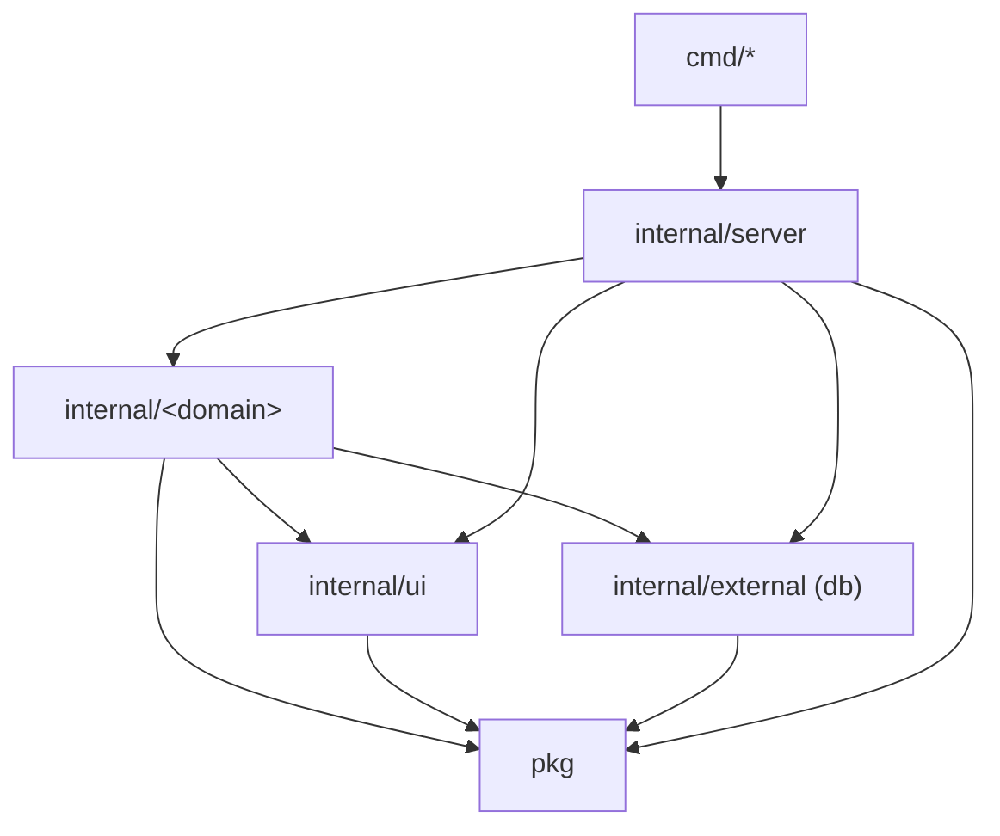
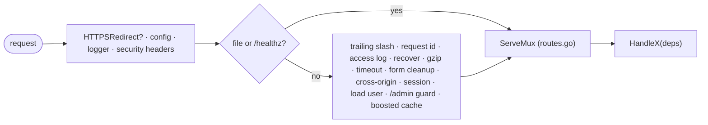

# LEANGO: the lean-go architecture

This project starts from [lean-go](https://github.com/tung-dnt/lean-go), and this file is its architecture reference:
what the template is, how the code is cut, and which imports are allowed. What the project itself does belongs in
[README.md](README.md).

lean-go is a template for a server-rendered Go web app on the standard library: `net/http`, PostgreSQL through sqlc,
gomponents views, htmx and Alpine. No router framework, no ORM, no DI container. It ships one example domain (`note`)
and the login of one admin account, so that every rule below has code that follows it and a test that holds it.

It was extracted from a production app that started from [Pagoda](https://github.com/mikestefanello/pagoda) and
outgrew its container/Echo structure; [ADR 0001](docs/adr/0001-lean-stdlib-go.md) says why. The quality bar is
[CONSTRAINTS.md](CONSTRAINTS.md); the recipes for handlers, forms, sessions, tests and the rest are in
[docs/conventions](docs/conventions/), and [AGENTS.md](AGENTS.md) says which one to read for which change.

## Start a project from it

1. On GitHub, **Use this template** → create your repository, and clone it.
2. Rename the module and the app (replace `github.com/you/app` and `app`):

   ```bash
   go mod edit -module github.com/you/app
   grep -rl 'github.com/tung-dnt/lean-go' --include='*.go' . | xargs sed -i '' 's#github.com/tung-dnt/lean-go#github.com/you/app#g'
   grep -rl 'leango' --exclude-dir=node_modules . | xargs sed -i '' 's/leango/app/g'   # db name, user, app name
   ```

   (`sed -i ''` is macOS; on Linux drop the `''`.) The second line also renames `module` in
   `internal/architecture_test.go`; set `name` in `package.json` by hand.
3. `just install && just db-up && just migrate-up && just run`, and open <http://localhost:8000>.
4. Build your first domain next to `internal/note` (see "Adding a domain"), then delete `note`: its package, its
   routes, its paths, its migration and queries, its row in the architecture test and `web/js/note`.
5. Put your name and the date in [CONSTRAINTS.md](CONSTRAINTS.md), and set `GO_APP_ENCRYPTIONKEY` on every live
   environment: the key in `config/config.yaml` is public.
6. Fill in the placeholders of [README.md](README.md) with what your project is.

## Architecture

One binary on the standard library: `http.ServeMux` with method and path patterns, middleware as
`func(http.Handler) http.Handler`, and no router framework, DI container or `init()` registration.

```
cmd/web/main.go           # calls server.Run(ctx, os.Args, os.Getenv, os.Stdout, os.Stderr), nothing else
cmd/admin                 # makes the admin account and prints its password once
internal/
├── server/               # Run (config, database, sessions, http.Server, shutdown), NewServer (the middleware
│   │                     #   every page goes through), routes.go (EVERY route), the file, probe and 404 handlers
│   ├── paths/            #   the typed path of every route (paths.Note(id)): what links, forms and redirects say
│   └── servertest/       #   the real server for tests: visitor, requests, accounts, fault injection
├── ui/                   # the page shell: layouts, components, icons, request helpers
├── auth/                 # /login, /logout, password hashing
├── note/                 # the example domain: list, post, show, admin delete
└── external/             # adapters over third-party services
    └── db/               #   migrations/, queries/, and the Go that sqlc generates from them
pkg/                      # domain-agnostic code: config, middleware, session, form, pager, log, ...
web/js/                   # TypeScript bundled into app.js, cut into areas like internal/ is cut into domains
public/                   # embedded static files (main.css, app.js, images)
```



**Domains** are one flat package each, split by concern, with no sub-packages: `<domain>.go` (types, rules and
handlers), `views.go` (gomponents), `state.go` only where a workflow needs it, and the end-to-end tests. Split a file
further only once it passes ~800 lines. A handler is made by `HandleX(deps...) http.Handler` that takes only what it
uses, and `internal/server/routes.go` lists every route. `cmd/<binary>` holds entrypoints only (parse config, build,
run), and the Go that sqlc generates into `internal/external/db` is never edited by hand.

**Edges.** A domain imports `pkg`, `internal/ui`, `internal/external`, `internal/server/paths`, and no other domain
unless the edge is listed in `domains` of `internal/architecture_test.go`. Domains link to each other's pages through
the typed path functions of `internal/server/paths` (`paths.Note(id)`), not by importing. `pkg` and
`internal/external` import no domain, no `internal/server` and no `internal/ui`; `internal/ui` imports no domain and
nothing of `internal/server` but `internal/server/paths`, which imports nothing of the module (so there is no cycle);
only `internal/server` imports the domains, and `cmd/*` imports only the server, `pkg` and `internal/external` (plus
the edges of `cmdAllowed`: `cmd/admin` also imports `auth`). The libraries the standard library replaced (echo,
gorilla, go-playground/validator, chi) are not imported anywhere, and a third-party SDK only under
`internal/external`. `internal/architecture_test.go` checks every import against these rules, and the same for the
imports of `web/js`, so a new edge fails the build until the rule and this paragraph change together.

**Request path.** Everything a page goes through is in `NewServer`, in order and with the reason for each place:



### Adding a domain

1. Create the flat package `internal/<d>/` with its `HandleX` makers, its `views.go`, and an external test package
   (`<d>_test`) that starts the server with `servertest.Main`. Copy `internal/note` as the starting point.
2. Add a migration (`just migrate-new <name>`) and its queries under `internal/external/db/queries/`, then
   `just sqlc`.
3. Add its routes to `internal/server/routes.go` and its paths to `internal/server/paths`, with a row for each in
   `internal/server/paths_test.go`.
4. List it in `domains` of `internal/architecture_test.go` (and any other domain it may import).
5. `just check`.

The recipe for each step is in [docs/conventions](docs/conventions/): routes and paths, handlers and errors, forms,
sessions, tests, data.

### Tests

Every domain is tested end to end: the real server against a real PostgreSQL, driven over HTTP as a browser would.
Tests need Docker and nothing else. How to write one: [docs/conventions/testing.md](docs/conventions/testing.md).

### Frontend

`web/js` is the TypeScript that `just js` bundles with esbuild into `public/static/js/app.js` (htmx and Alpine
included, so nothing loads from a CDN; a dynamic `import()` becomes a chunk of its own). It is cut into area folders
the way `internal/` is cut into domains, and `internal/architecture_test.go` holds its imports to a table too:

| Where | Imports |
|---|---|
| `app.ts` (the entry), `register.ts` (the Alpine registry), `globals.d.ts` | every area, and each other |
| `note/`: the character count of the note form | `shell/` |
| `shell/`: htmx behaviour (view transitions, error pages swapped in) | no other area |

A component is an Alpine component in its area, registered in `register.ts` and named in the markup with `x-data`
(`charCount` in `internal/note/views.go`); the recipe is [docs/conventions/frontend.md](docs/conventions/frontend.md).
A new area, or an edge the table lacks, is a row here and in `webAreas` in the test. Styles are Tailwind + daisyUI,
built by the standalone Tailwind CLI from the classes in `internal/**/*.go` (`tailwind.css`).
