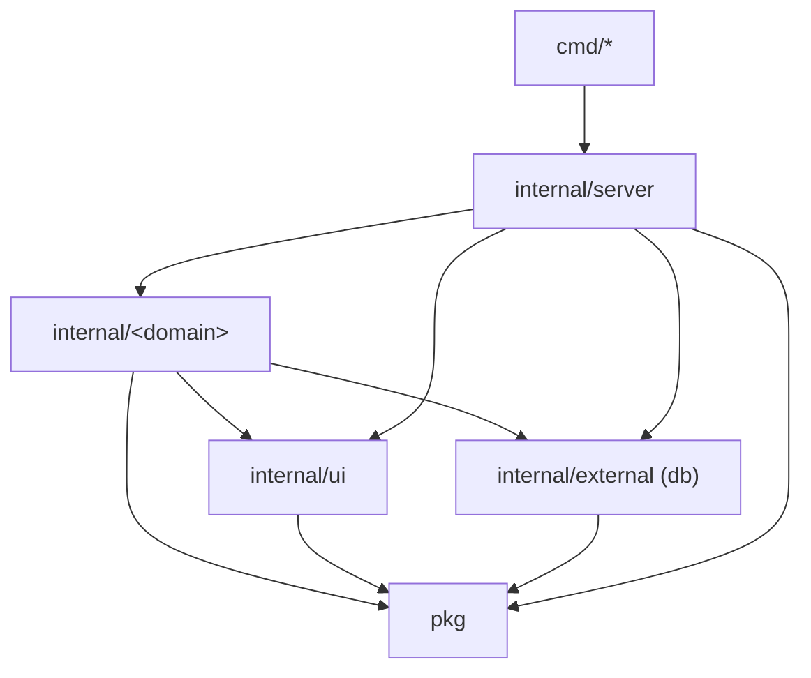
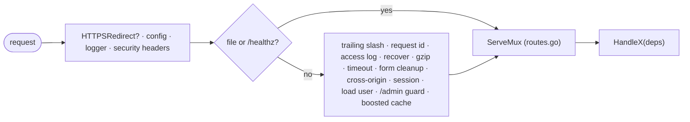

# lean-go

A template for a server-rendered Go web app on the standard library: `net/http`, PostgreSQL through sqlc, gomponents
views, htmx and Alpine. No router framework, no ORM, no DI container. It ships one example domain (`note`) and the
login of one admin account, so that every rule below has code that follows it and a test that holds it.

It was extracted from a production app that started from [Pagoda](https://github.com/mikestefanello/pagoda) and
outgrew its container/Echo structure; [ADR 0001](docs/adr/0001-lean-stdlib-go.md) says why. The rules are in
[CONSTRAINTS.md](CONSTRAINTS.md).

## Start a project from it

1. On GitHub, **Use this template** → create your repository, and clone it.
2. Rename the module and the app (replace `github.com/you/app` and `app`):

   ```bash
   go mod edit -module github.com/you/app
   grep -rl 'github.com/tung-dnt/lean-go' --include='*.go' . | xargs sed -i '' 's#github.com/tung-dnt/lean-go#github.com/you/app#g'
   grep -rl 'leango' --exclude-dir=node_modules . | xargs sed -i '' 's/leango/app/g'   # db name, user, app name
   ```

   (`sed -i ''` is macOS; on Linux drop the `''`.) The second line also renames `module` in
   `internal/architecture_test.go`; set `name` in `package.json` by hand.
3. `make install && make db-up && make migrate-up && make run`, and open <http://localhost:8000>.
4. Build your first domain next to `internal/note` (see "Adding a domain"), then delete `note`: its package, its
   routes, its paths, its migration and queries, its row in the architecture test and `web/js/note`.
5. Put your name and the date in [CONSTRAINTS.md](CONSTRAINTS.md), and set `GO_APP_ENCRYPTIONKEY` on every live
   environment: the key in `config/config.yaml` is public.

## Architecture

One binary on the standard library: `http.ServeMux` with method and path patterns, middleware as
`func(http.Handler) http.Handler`, and no router framework, DI container or `init()` registration.

```
cmd/web/main.go           # calls server.Run(ctx, os.Args, os.Getenv, os.Stdout, os.Stderr), nothing else
cmd/admin                 # makes the admin account and prints its password once
internal/
├── server/               # Run (config, database, sessions, http.Server, shutdown), NewServer (the middleware
│   │                     #   every page goes through), routes.go (EVERY route), the file, probe and 404 handlers
│   └── servertest/       #   the real server for tests: visitor, requests, accounts, fault injection
├── ui/                   # the page shell: layouts, components, icons, request helpers
├── auth/                 # /login, /logout, password hashing
├── note/                 # the example domain: list, post, show, admin delete
└── external/             # adapters over third-party services
    └── db/               #   migrations/, queries/, and the Go that sqlc generates from them
pkg/                      # domain-agnostic code: config, middleware, session, form, paths, pager, log, ...
web/js/                   # TypeScript bundled into app.js, cut into areas like internal/ is cut into domains
public/                   # embedded static files (main.css, app.js, images)
```



**Domains** are one flat package each, split by concern: `<domain>.go` (handlers and logic), `views.go`
(gomponents), `state.go` only where a workflow needs it, and the tests. A handler is made by
`HandleX(deps...) http.Handler` that takes only what it uses, and `internal/server/routes.go` lists every route.

**Edges.** A domain imports `pkg`, `internal/ui`, `internal/external`, and no other domain unless the edge is listed
in `domains` of `internal/architecture_test.go`. Domains link to each other's pages through the typed path functions
of `pkg/paths` (`paths.Note(id)`), not by importing. `pkg` and `internal/external` import no domain, no
`internal/server` and no `internal/ui`; `internal/ui` imports no domain and no server; only `internal/server` imports
the domains, and `cmd/*` imports only the server, `pkg` and `internal/external` (`cmd/admin` also `auth`). Echo,
gorilla, go-playground/validator and chi are not imported anywhere, and a third-party SDK only under
`internal/external`. `internal/architecture_test.go` checks every import against these rules, so a new edge fails the
build until the rule and this paragraph change together.

**Request path.** Everything a page goes through is in `NewServer`, in order and with the reason for each place:



### Adding a domain

1. Create the flat package `internal/<d>/` with its `HandleX` makers, its `views.go`, and an external test package
   (`<d>_test`) that starts the server with `servertest.Main`. Copy `internal/note` as the starting point.
2. Add a migration (`make migrate-new name=...`) and its queries under `internal/external/db/queries/`, then
   `make sqlc`.
3. Add its routes to `internal/server/routes.go` and its paths to `pkg/paths`, with a row for each in
   `internal/server/paths_test.go`.
4. List it in `domains` of `internal/architecture_test.go` (and any other domain it may import).
5. `make check`.

The conventions for errors, forms, sessions, guards and tests are the "Server conventions" of
[CONSTRAINTS.md](CONSTRAINTS.md).

### Tests

End to end: `servertest.Main` starts the real server (`server.Run`) against a real PostgreSQL, and a test drives it
with HTTP requests as a browser would (cookie jar, no redirect following, goquery for the markup). A test that has to
break the database, or count every row, starts a server of its own with `servertest.Start`, and
`FailQuery(t, table, "ListNotes")` makes one sqlc-named query fail while every other query is the real one. Only pure
functions and the SQL of `internal/external/db` have unit tests. A test package is the external one of its domain
(`package note_test`).

Tests need Docker and nothing else: the first test of each process starts a throwaway `postgres:17-alpine`
(`pkg/testdb`, testcontainers), and each process isolates itself in a randomly-named schema. Set
`GO_DATABASE_TESTCONNECTION` to use a database you already have (CI does).

### Frontend

`web/js` is the TypeScript that `make js` bundles with esbuild into `public/static/js/app.js` (htmx and Alpine
included, so nothing loads from a CDN; a dynamic `import()` becomes a chunk of its own). It is cut into area folders
the way `internal/` is cut into domains, and `internal/architecture_test.go` holds its imports to a table too:

| Where | Imports |
|---|---|
| `app.ts` (the entry), `register.ts` (the Alpine registry), `globals.d.ts` | every area, and each other |
| `note/`: the character count of the note form | `shell/` |
| `shell/`: htmx behaviour (view transitions, error pages swapped in) | no other area |

A component is an Alpine component in its area, registered in `register.ts` and named in the markup with `x-data`
(`charCount` in `internal/note/views.go`). A new area, or an edge the table lacks, is a row here and in `webAreas` in
the test. Styles are Tailwind + daisyUI, built by the standalone Tailwind CLI from the classes in `internal/**/*.go`
(`tailwind.css`).

## Getting started

```bash
make install     # Go modules + pinned tools (sqlc, air, esbuild, govulncheck) + the Tailwind CLI + bun packages
make db-up       # start PostgreSQL for `make run` (not needed for `make test`)
make migrate-up  # apply the schema migrations
make run         # build the CSS and JS and run the application on :8000
make admin ADMIN_EMAIL=me@example.com   # create the admin account; the password is printed once
make watch       # run with air, rebuilding on change
make help        # every target
```

Configuration is `config/config.yaml`, and every key is overridable as `GO_<SECTION>_<KEY>`
(`GO_HTTP_PORT`, `GO_DATABASE_CONNECTION`, `GO_APP_ENCRYPTIONKEY`, ...). Secrets go in an untracked `.env`
(`cp .env.example .env`): `make` exports every variable in it to the commands it runs. In production, set the same
variables in the deploy platform's environment instead; `.env` is excluded from the Docker build context.

## Changing the schema

```bash
make migrate-new name=add_posts   # create the migration files
# ...write the up/down SQL, then add queries under internal/external/db/queries/
make sqlc                         # regenerate the type-safe Go code
make migrate-up                   # apply it to the local database
```

sqlc reads the migrations directory as its schema source, so the generated code always matches the migrated schema.
The migrations are also embedded in the binary (`internal/external/db/embed.go`): the test environment migrates its
throwaway schema with them, while a real environment is migrated with the `migrate-*` targets, never on startup.

Things an ORM would do for you are explicit: emails are lowercased in SQL (`LOWER()`), and a password is hashed with
`auth.HashPassword` before it is stored.

## Checks

```bash
make test    # go test -race -cover ./... (builds main.css and app.js first)
make check   # sqlc-verify, lint, vuln, typecheck, test, build: what a finished task must pass
```

## Deploying

`Dockerfile` builds a static binary into a `scratch` image (non-root, CA certificates and zoneinfo included) with the
same `make css js` targets as local development. Run it with `GO_APP_ENVIRONMENT=prod`, `GO_APP_HOST`,
`GO_DATABASE_CONNECTION` and `GO_APP_ENCRYPTIONKEY`; probe readiness at `/healthz`. Behind a reverse proxy, keep the
app's port reachable from the proxy alone: `X-Forwarded-For` is believed only from loopback and private networks
(`middleware.RealIP`).
